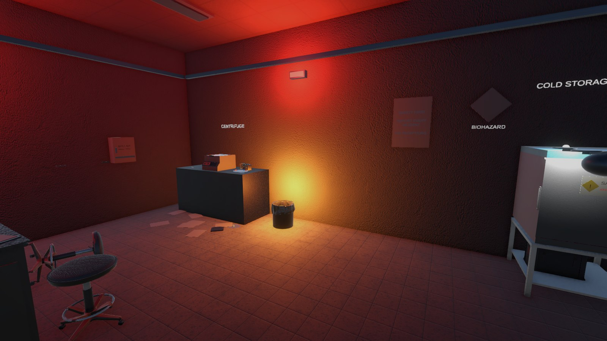
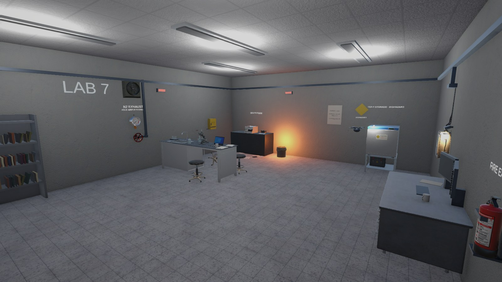
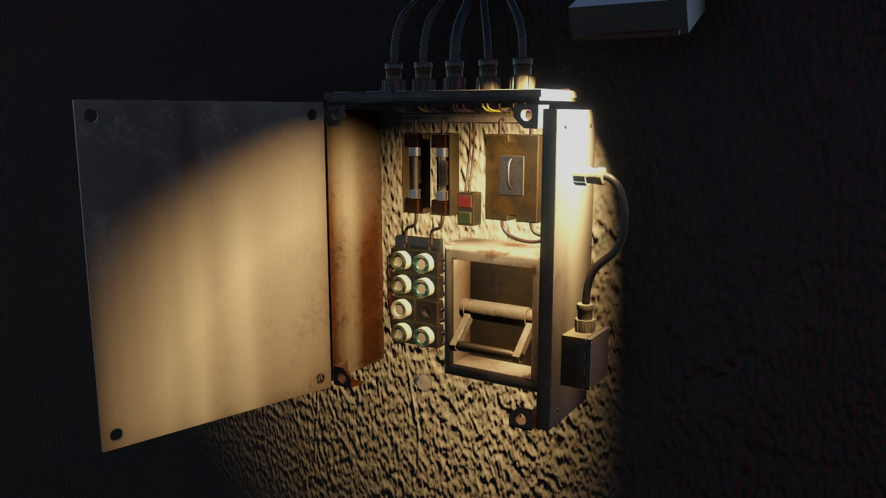
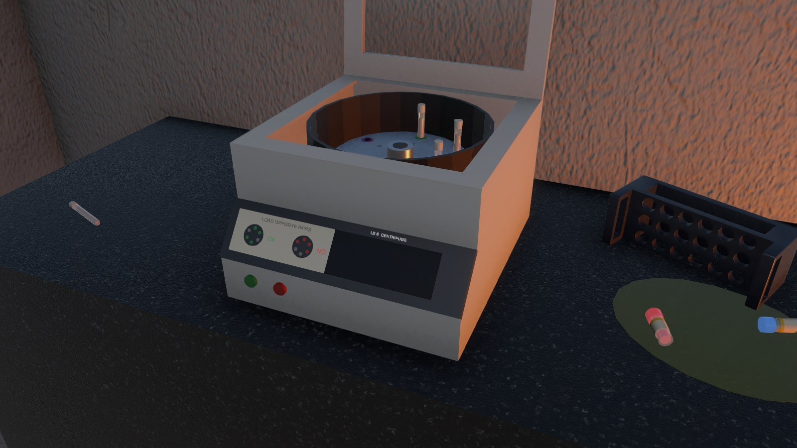
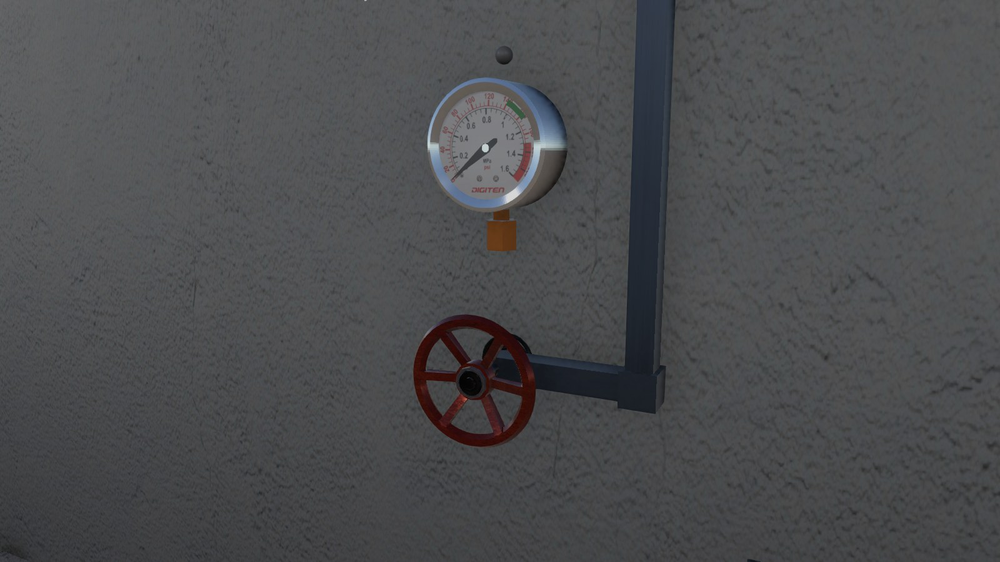
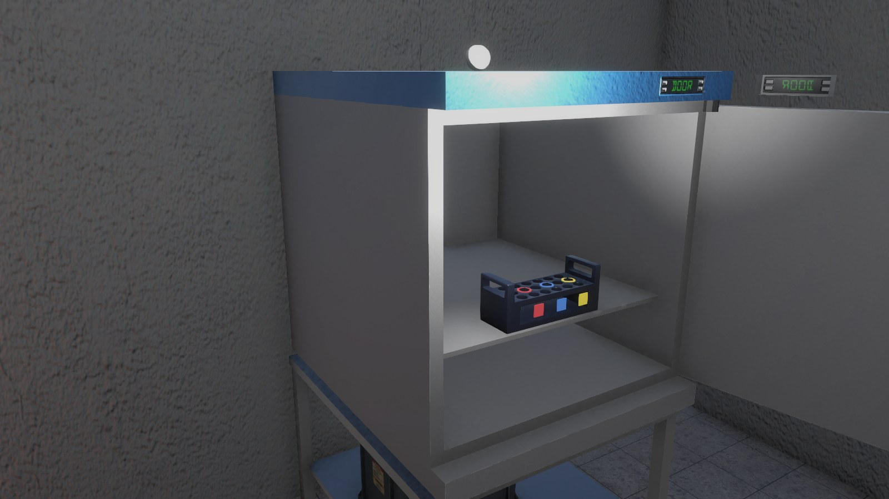

# The Lab

**A VR escape room for PC VR, built in Unity 6 with the XR Interaction Toolkit and OpenXR.**

You wake up on the floor of a sealed research lab. Your own unbalanced centrifuge run started a chain of failures: the power is out, a bin is on fire, the air is full of nitrogen and hazardous samples are spilled across the bench. D-7, the lab's sarcastic safety drone, talks you through restoring power, making the room safe and getting out.

[](https://youtu.be/CjcZjJJBniY)

▶ **[Watch the highlights (90 s)](https://youtu.be/CjcZjJJBniY)** · [Full playthrough (5 min)](https://youtu.be/HChVFxMmSKM)



| | |
|---|---|
|  |  |
|  |  |

---

## How a run plays out

1. **Power.** The lab is dark except for red emergency lamps. Find the fuse box, pull the burnt fuse, find a spare of the right size in the desk drawers (two decoys are the wrong size and do not fit) and push the main switch up.
2. **Safety checklist.** The lockdown keeps the door shut until four tasks are green, in any order:
   - **Fire**: take the extinguisher off its bracket and spray the burning bin until it is out.
   - **Air**: open the exhaust valve slowly and hold the pressure needle in the green band. Rushing it trips an alarm and the system vents.
   - **Centrifuge**: open the lid, load the tubes in opposite pairs and close it. An unbalanced load shakes and rattles; a balanced one spins up and passes its test run.
   - **Samples**: pick the spilled vials up with tongs (bare hands cannot), put each one in the matching slot of the cold storage rack and close the fridge.
3. **Exit.** Pull the manual door release with both hands and walk out. The end screen shows your time.

Tasks can be undone: open the fridge again or unbalance the centrifuge and that item turns red on the checklist, which keeps the room behaving like a real space rather than a series of one-way triggers.

## What is worth looking at

**Interaction design**
- **Press to open.** Doors, drawers, the centrifuge lid and the fuse box switch open with one button press and show an on-object prompt ("Press R1 to open"), after a first-time playtester struggled to pull them open physically. The puzzles are untouched: they still read the same 0–1 `Value` from the hinge or the slider.
- **Constrained interactables.** `ConstrainedDial` (hinges, the valve wheel, more than a full turn for fine control) and `ConstrainedSlider` (drawers, moved through the physics step so their contents ride along) are custom `XRBaseInteractable`s that project the hand onto one axis.
- **Two-handed lever** that measures how far the hands move along the handle's arc rather than their angle around the pivot, so it can be pulled from a comfortable distance or with a ray, not only standing against the wall.
- **Locks as select filters.** Closed containers, a running centrifuge and fuses after power-up are locked with `IXRSelectFilter`s instead of disabling components, because a disabled interactable can still be grabbed and disabling a socketed item drops it.
- **Tongs** with a trigger-driven socket at the tip, on their own interaction layer, so hazardous vials can only be handled with them.

**Systems**
- **Puzzle framework** (`Core/`): `PuzzleStep` (activate, solve, unsolve, static events), `PuzzleGroup` (parallel tasks in any order) and `PuzzleSequencer` (power → checklist → lever, with regression when a finished task breaks). Puzzles know nothing about the coach, the terminal or the lights; everything reacts to the events.
- **Coach director** (`Coach/`): D-7 listens to those events and decides what to say. Hints are graded from gentle to direct, shared across open tasks so each gets its gentle hint first, and keep cycling while the player is stuck. After each task it suggests the nearest open one, and the drone flies to a point of interest only when the line about it starts playing.
- **Game flow**: main menu and end screen in a separate dark room, so the lab cannot be explored before START; settings (master, music, voice) available in game; a spectator camera with a wider, smoothed view for recording.

## Built with

| | |
|---|---|
| Engine | Unity 6000.3.4f1, Universal Render Pipeline 17.3 |
| XR | XR Interaction Toolkit 3.3.2, OpenXR 1.18, Input System 1.17 |
| Tested on | PlayStation VR2 with the PC adapter, through SteamVR (RTX 5070) |
| Audio | Voice lines and sound effects generated with ElevenLabs |

## Running it

1. Open the project in **Unity 6000.3.4f1**.
2. Open `Assets/Scenes/The Lab.unity` and press Play.
3. **With a headset:** any OpenXR headset running through SteamVR should work; the project was played on PS VR2.
   **Without a headset:** enable the `XR Interaction Simulator` object in the scene to play with mouse and keyboard.

### Controls

| Action | Controller | Simulator |
|---|---|---|
| Move / turn | Left stick / right stick | WASD / mouse |
| Teleport | Push the right stick forward | |
| Grab, open, press | Grip (L1 / R1 on PS VR2 Sense) | |
| Use a held tool (extinguisher, tongs) | Trigger | |
| Safety checklist | X or A | 3 |
| Settings | Y | Esc |

## Project layout

```
Assets/Scripts/
  Core/           puzzle framework, game flow, menu
  Puzzles/        one script per task (power, fire, air, centrifuge, samples, lever)
  Interactables/  custom XRI interactables, sockets, tools, press-to-open
  Coach/          D-7: director, speech queue, drone movement
  World/          lighting, audio, checklist panel, hints, spectator camera
docs/THE_LAB_GAME_BRIEF.md   design brief: story, room layout, puzzle design
CREDITS.md                   every third-party model and texture, with licences
```

## Credits

All models and textures are CC0 or CC BY and are listed with their authors in [CREDITS.md](CREDITS.md). D-7's voice ("Callum") and the sound effects and music were generated with [ElevenLabs](https://elevenlabs.io).

An earlier experiment that drives the XR rig from webcam hand tracking (MediaPipe) lives on the `webcam-hands` branch. It needs the MediaPipe Unity plugin, which is not included in the repository.
